# pmst-loop

磁疗仪固件升级资源仓库，包含 UI、STM32、DSP 相关程序包与下载工具，以及升级操作说明。

## 目录说明

| 目录 | 说明 |
| --- | --- |
| `DSP/` | DSP 下载工具与程序包 |
| `STM32/` | STM32 程序包与下载工具 |
| `UI/` | 界面程序包 |

### 主要文件

- **UI**：将 `UI/private` 目录复制到 SD 卡根目录用于界面升级
- **STM32**：`Fire_FreeRTOS.hex`（固件）、`ST-LINK Utility.zip`（烧录工具）
- **DSP**：`adi_sigmastudio-rel4.7-x64.zip`（SigmaStudio 工具）

---

## UI 程序升级

**重要提示：升级前需要设备关机。**

1. 找一个 4GB 大小的 SD 卡，格式化 SD 卡为 FAT32 格式。  
  

2. 将 UI 程序放到 SD 卡中（把 `private` 目录复制到 SD 卡根目录）。

    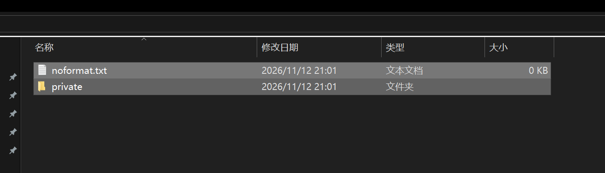
3. 将 SD 卡插入 UI 屏幕，注意黄色框里的电源排线，防止断裂。

   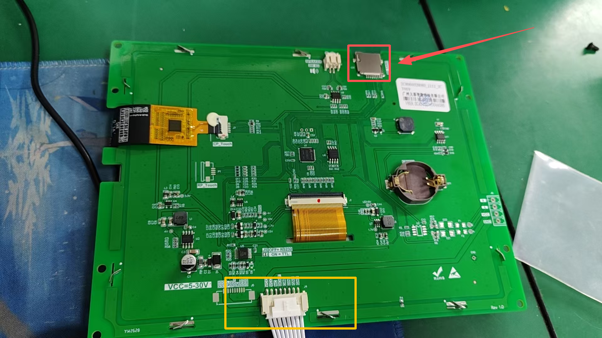
4. 设备开机，升级界面如下图所示。

   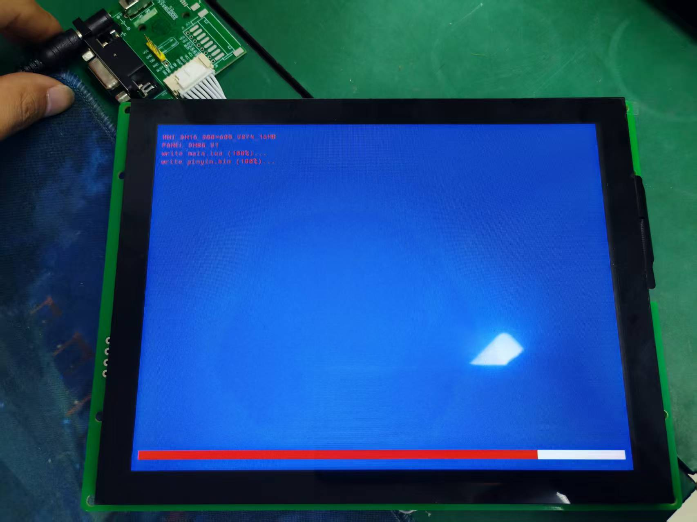
5. 升级完成后会提示移除 SD 卡。移除 SD 卡后，成功进入界面代表系统升级成功。

   

---

## STM32 单片机程序升级

**重要提示：升级前需要设备关机。**

### 硬件接线

1. 使用杜邦线，将 ST-LINK V2 的 2、4、6 脚连接到单片机 `SWCLK`、`SWDIO`、`GND` 引脚。
2. 将 ST-LINK V2 插入电脑，然后设备上电。

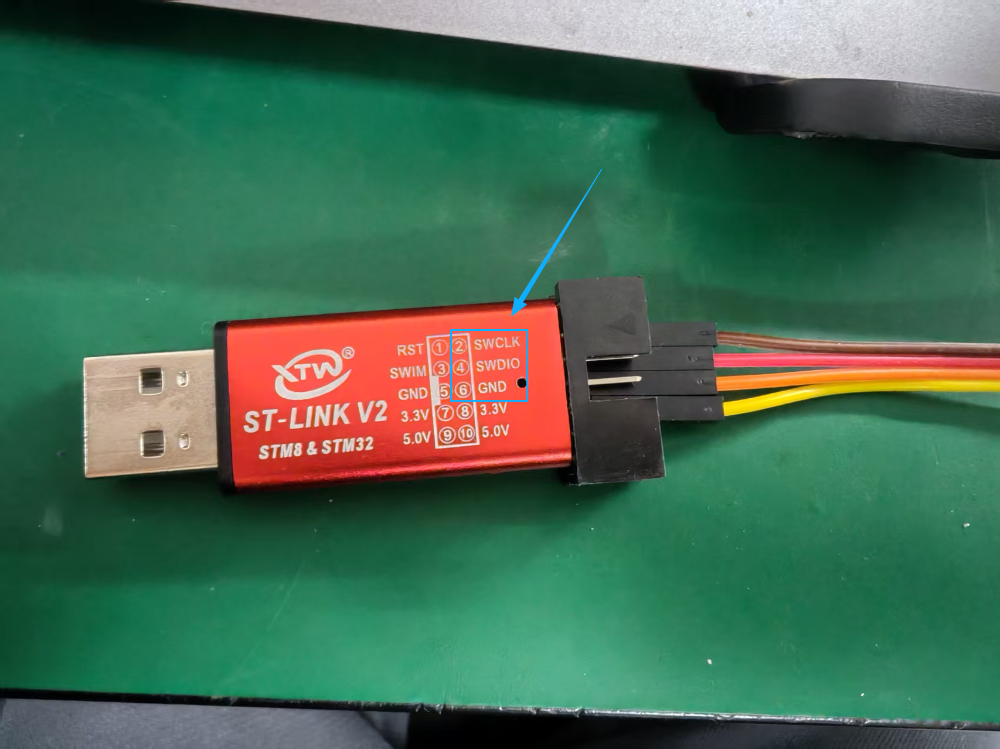

*ST-LINK V2 接线图*

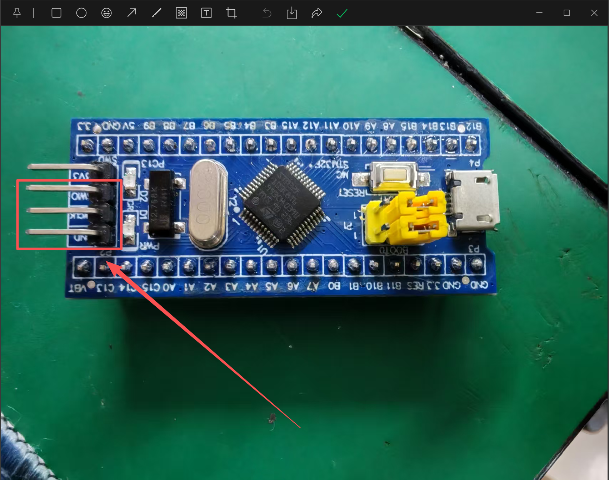

*STM32 单片机接线*

### 软件烧录程序

1. 打开 `STM32 ST-LINK Utility.exe` 工具。

   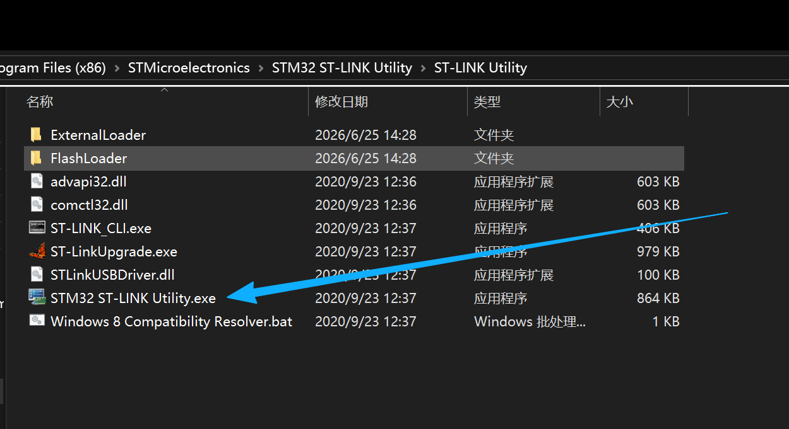
2. 点击软件的 **Target** 按钮，然后点击 **Connect**，如图：

   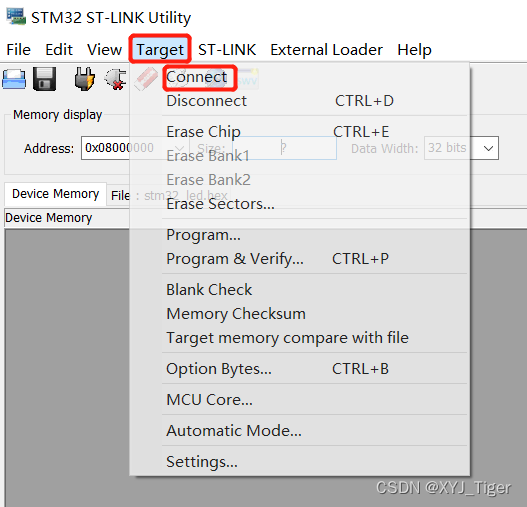
3. 如果连接成功，信息框会显示连接成功，如图：

   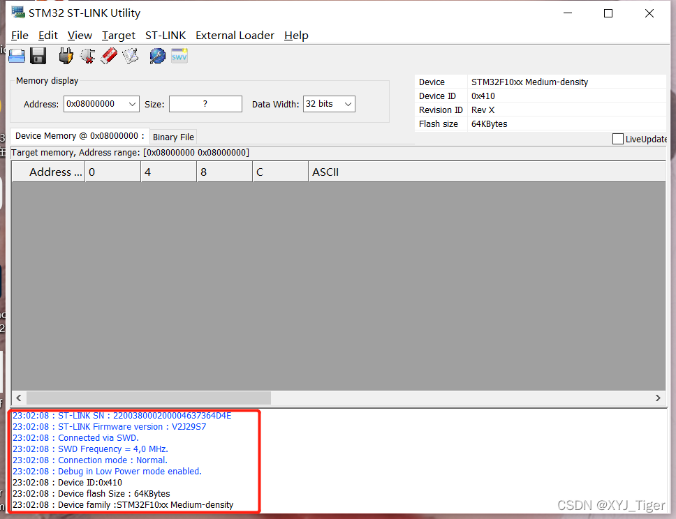
4. 连接完成后，打开 **File → Open file…**，选择需要烧写的 hex 文件（如 `Fire_FreeRTOS.hex`），如图：

   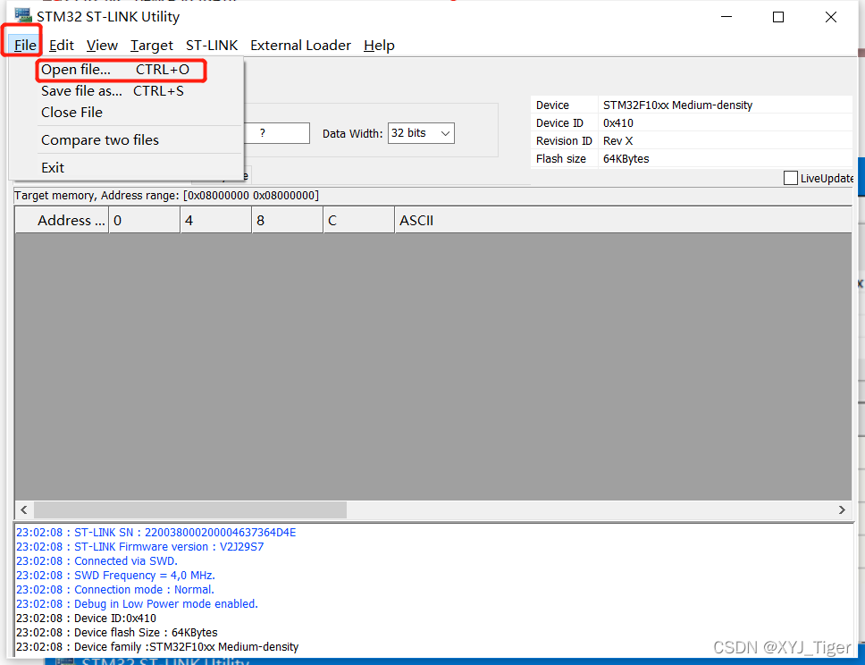
5. 选定好烧录固件后，选择 **Target**，点击 **Program & Verify**，完成烧录：

   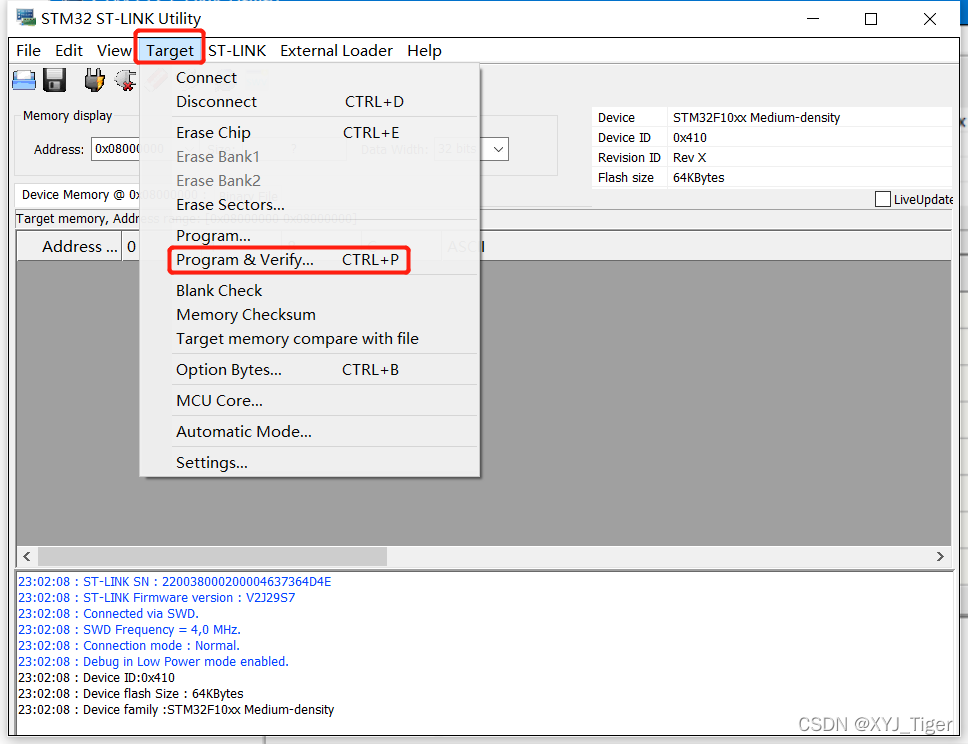
6. 点击 **Start** 开始烧录。

   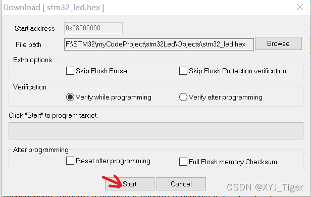
7. 烧录成功的效果如图：

   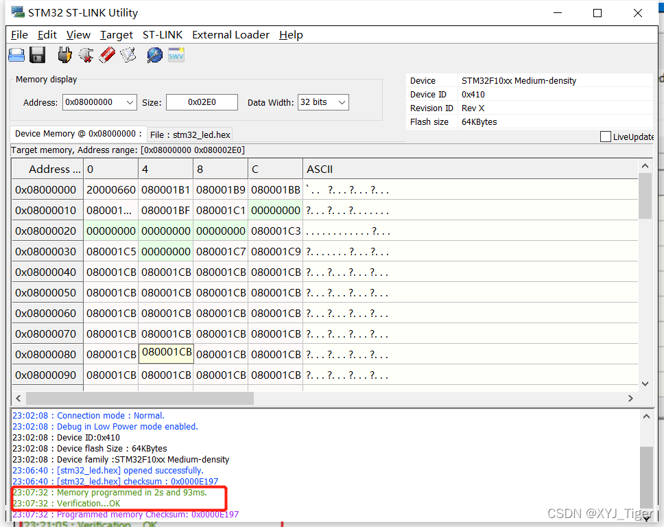
8. 烧录成功后重启设备即可。

---

## DSP 音频程序升级

**重要提示：升级前需要设备关机。**

### 硬件接线

设备处于关机状态；一端连接电脑，另一端连接 DSP 板卡。

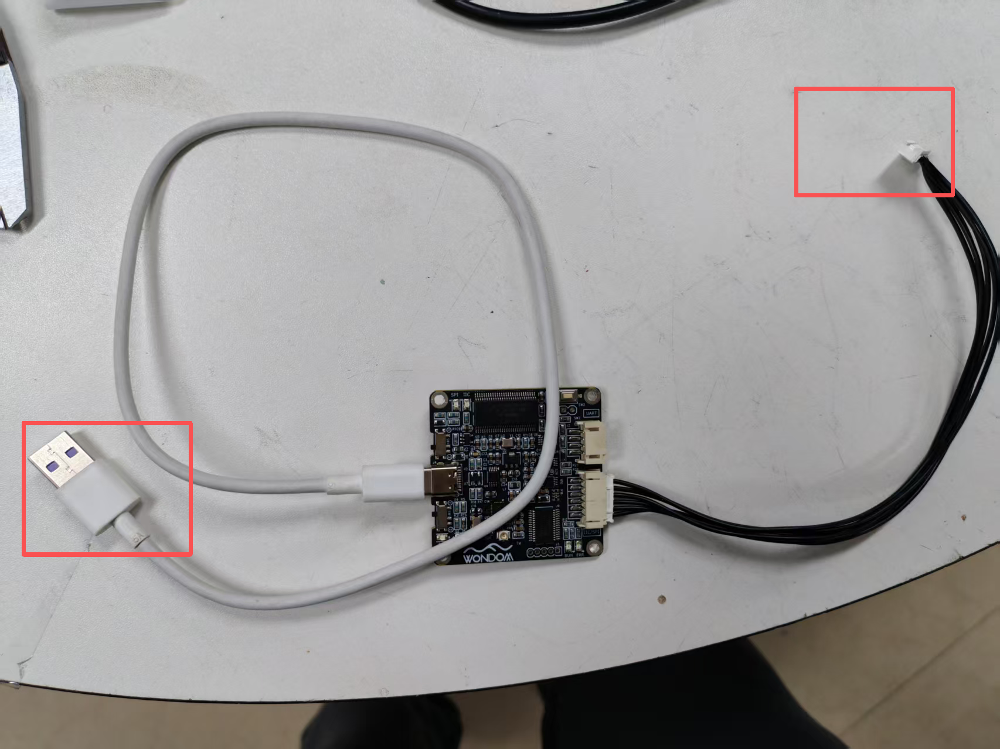

*DSP 硬件连接图*

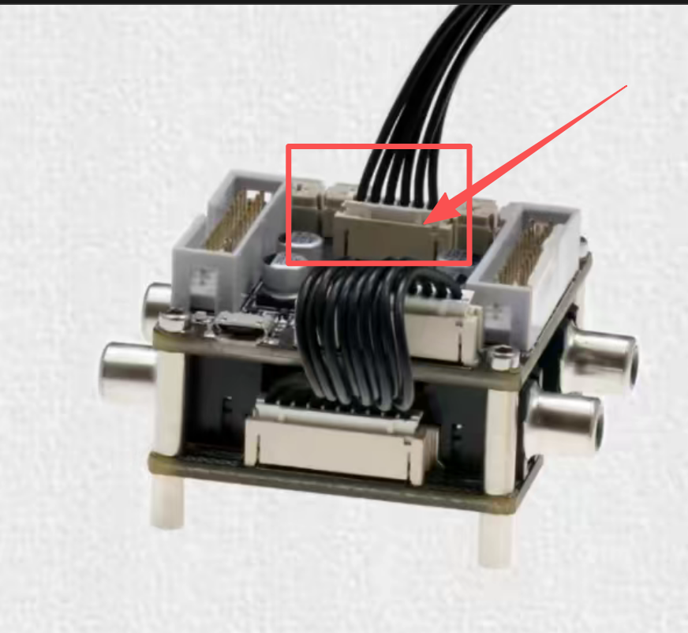

*DSP 板卡连接端*

### 软件烧录程序

1. 安装 `adi_sigmastudio-rel4.7-x64.zip` 工具。
2. 安装成功后，使用 SigmaStudio 打开 `APM2_SigmaStudio.dspproj` 文件。
3. 点击工具栏的 **Link Compile Connect**。

   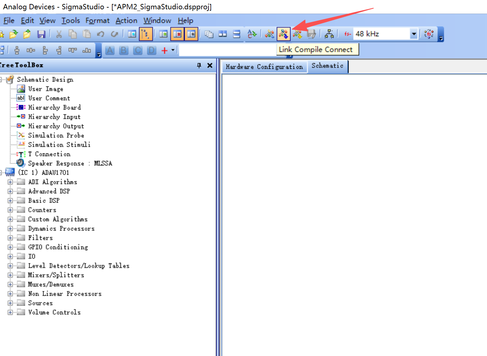
4. 点击 **Hardware Configuration** 中的 **Write E2PROM**，将程序固化到 E2PROM 中，然后重启设备。

   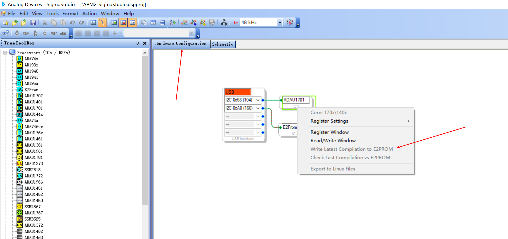
