# pmst-loop

Firmware upgrade repository for the magnetic therapy device. It contains UI, STM32, and DSP packages/tools, plus upgrade instructions.

## Directory layout

| Directory | Description |
| --- | --- |
| `DSP/` | DSP download tools and program packages |
| `STM32/` | STM32 program packages and download tools |
| `UI/` | UI program packages |

### Key files

- **UI**: Copy the `UI/private` directory to the SD card root for UI upgrade
- **STM32**: `Fire_FreeRTOS.hex` (firmware), `ST-LINK Utility.zip` (flash tool)
- **DSP**: `adi_sigmastudio-rel4.7-x64.zip` (SigmaStudio tool)

---

## UI firmware upgrade

**Important: Power off the device before upgrading.**

1. Prepare a 4 GB SD card and format it as FAT32.  
  

2. Copy the UI program onto the SD card (copy the `private` directory to the SD card root).

    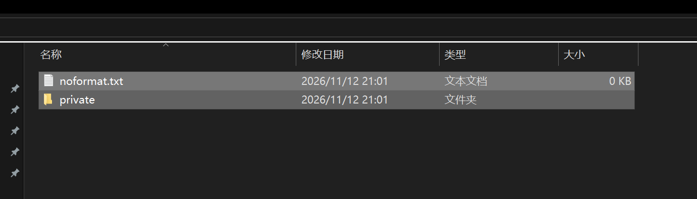
3. Insert the SD card into the UI screen. Be careful with the power cable in the yellow box to avoid breaking it.

   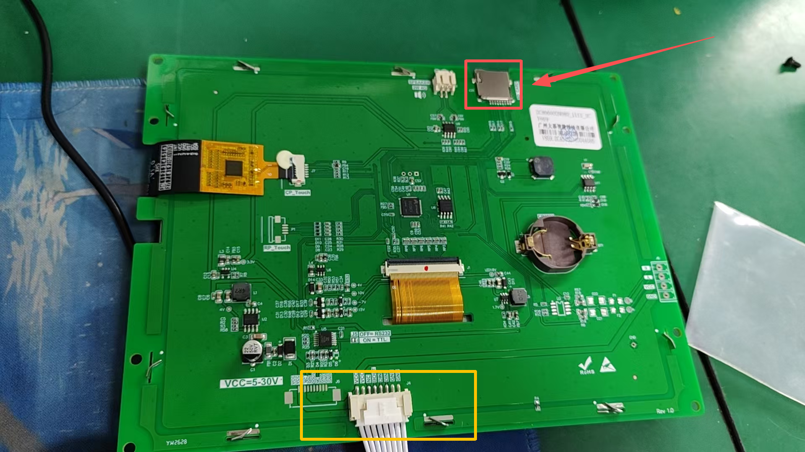
4. Power on the device. The upgrade screen looks like this:

   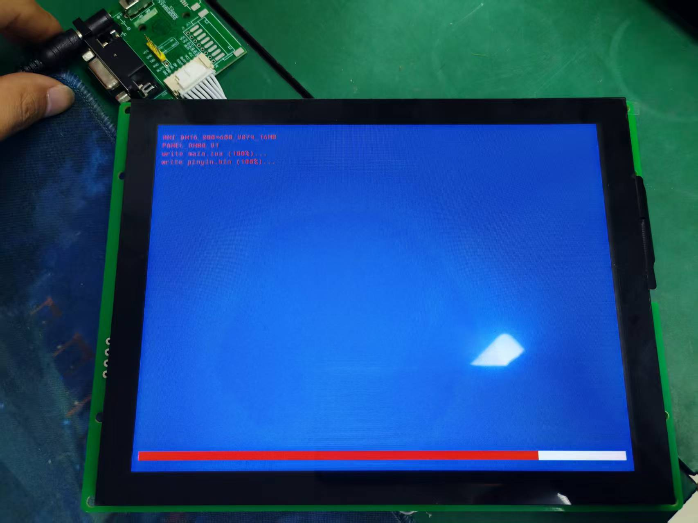
5. When the upgrade finishes, you will be prompted to remove the SD card. After removal, entering the UI successfully means the upgrade is complete.

   

---

## STM32 MCU firmware upgrade

**Important: Power off the device before upgrading.**

### Hardware wiring

1. Use Dupont wires to connect pins 2, 4, and 6 of the ST-LINK V2 to the MCU `SWCLK`, `SWDIO`, and `GND` pins.
2. Plug the ST-LINK V2 into the PC, then power on the device.

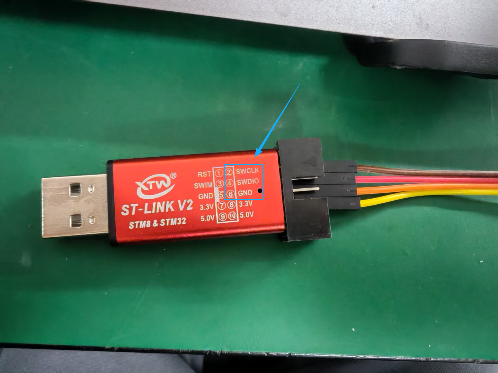

*ST-LINK V2 wiring diagram*

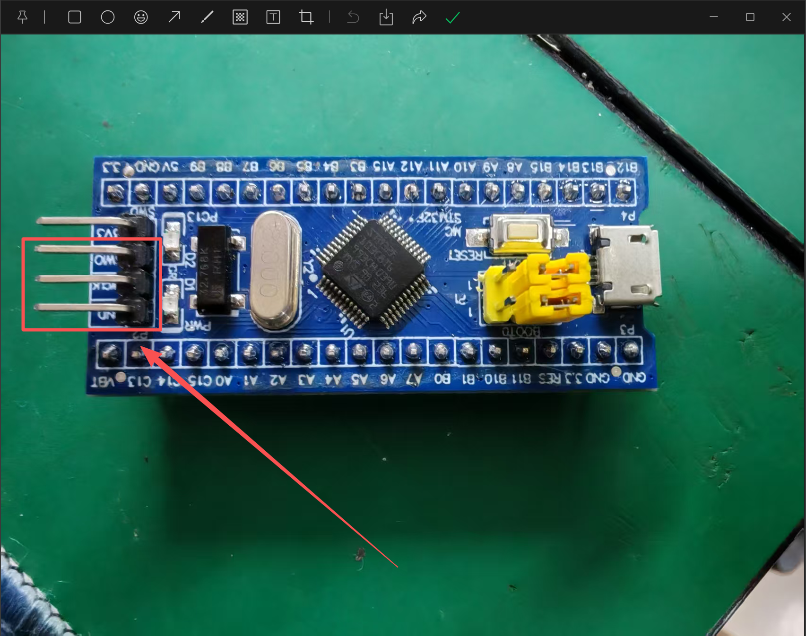

*STM32 MCU wiring*

### Software flashing

1. Open `STM32 ST-LINK Utility.exe`.

   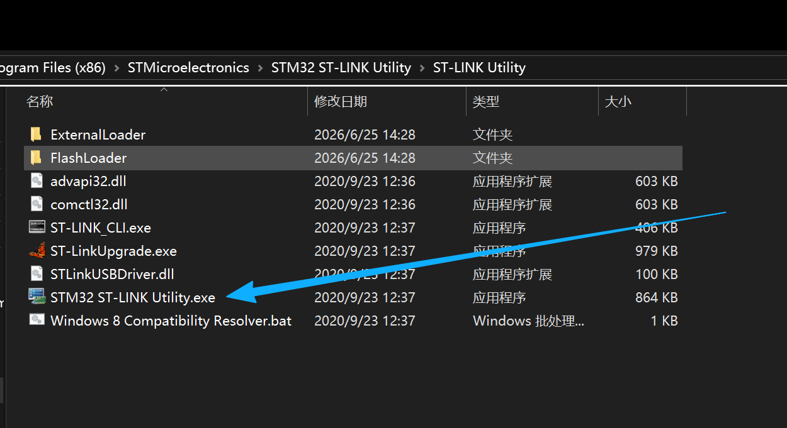
2. Click **Target**, then click **Connect**, as shown below:

   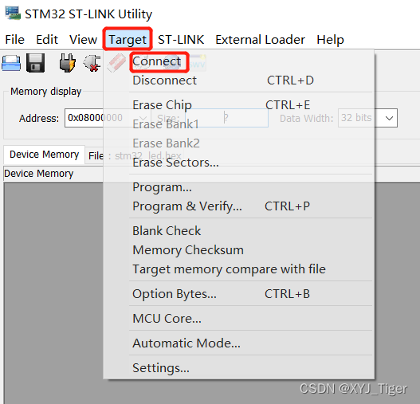
3. If the connection succeeds, the info panel shows a successful connection:

   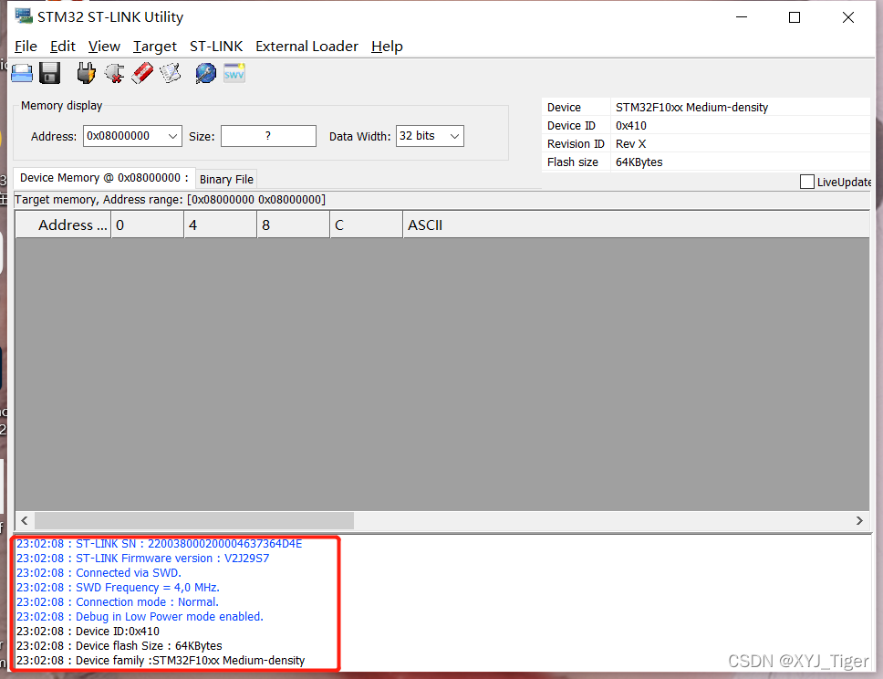
4. After connecting, open **File → Open file…** and select the hex file to flash (e.g. `Fire_FreeRTOS.hex`):

   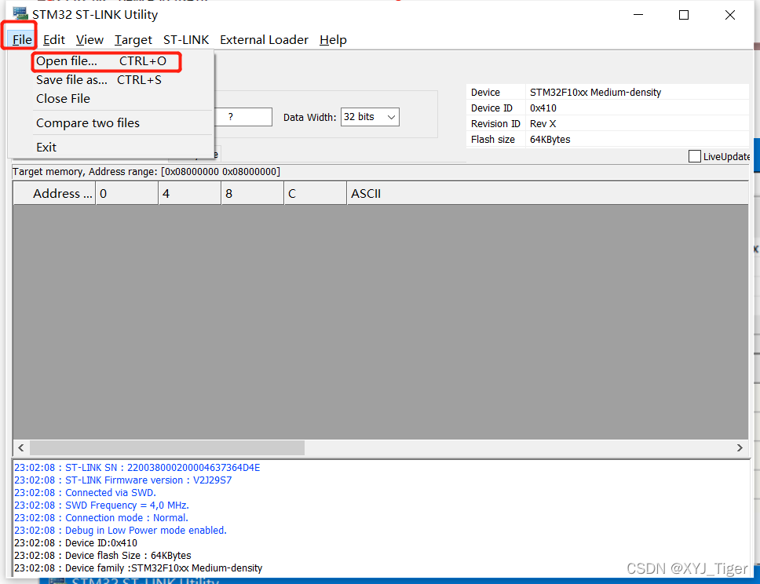
5. With the firmware selected, open **Target** and click **Program & Verify** to start programming:

   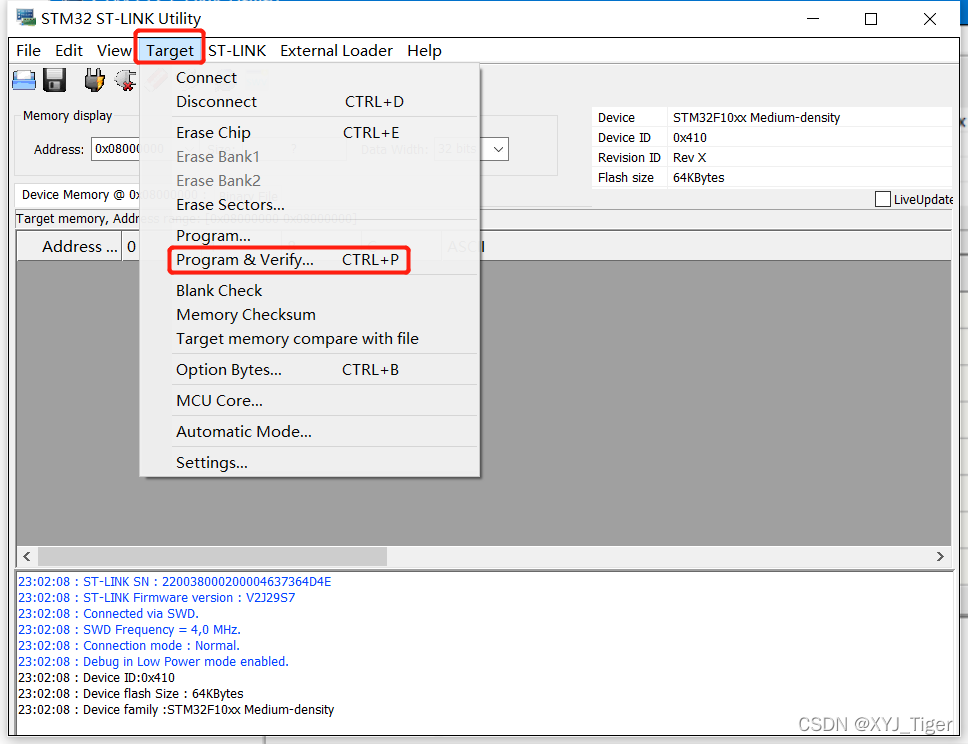
6. Click **Start** to begin flashing.

   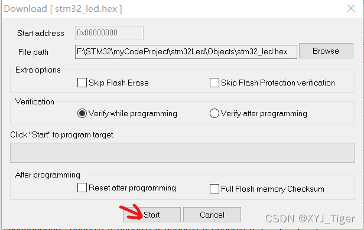
7. Successful programming looks like this:

   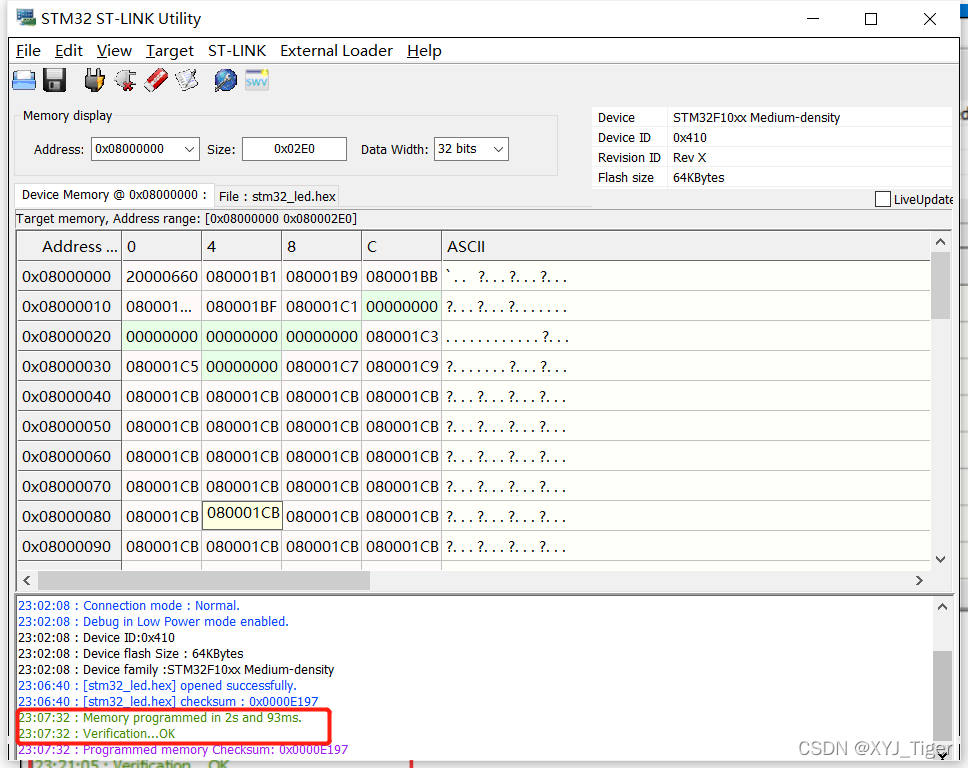
8. After a successful flash, reboot the device.

---

## DSP audio firmware upgrade

**Important: Power off the device before upgrading.**

### Hardware wiring

Keep the device powered off. Connect one end to the PC and the other end to the DSP board.

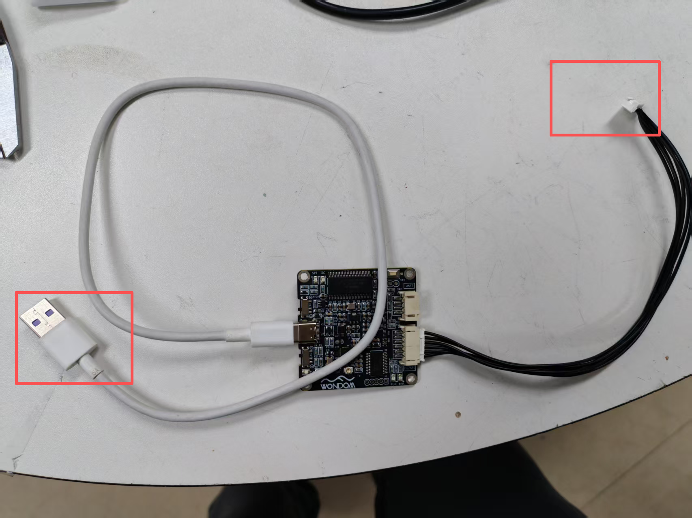

*DSP hardware connection*

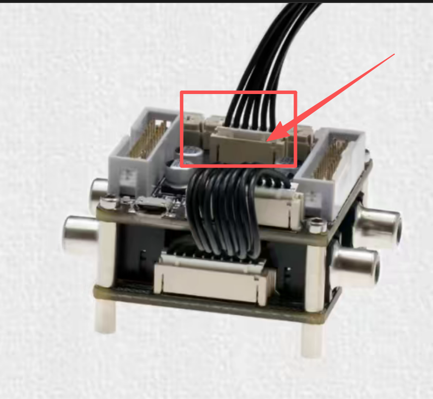

*DSP board connector*

### Software flashing

1. Install the tool from `adi_sigmastudio-rel4.7-x64.zip`.
2. After installation, open `APM2_SigmaStudio.dspproj` with SigmaStudio.
3. Click **Link Compile Connect** on the toolbar.

   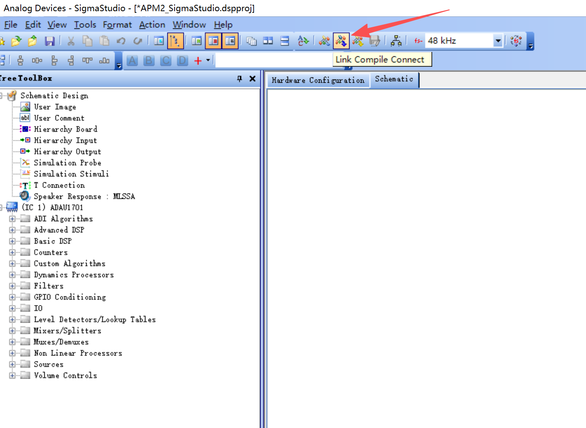
4. In **Hardware Configuration**, click **Write E2PROM** to write the program into E2PROM, then reboot the device.

   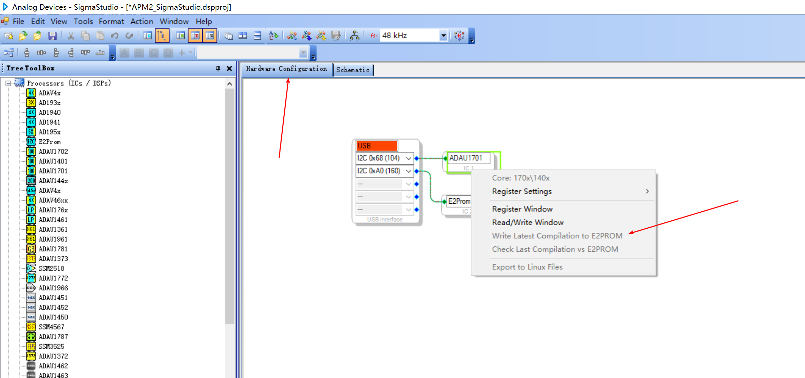
